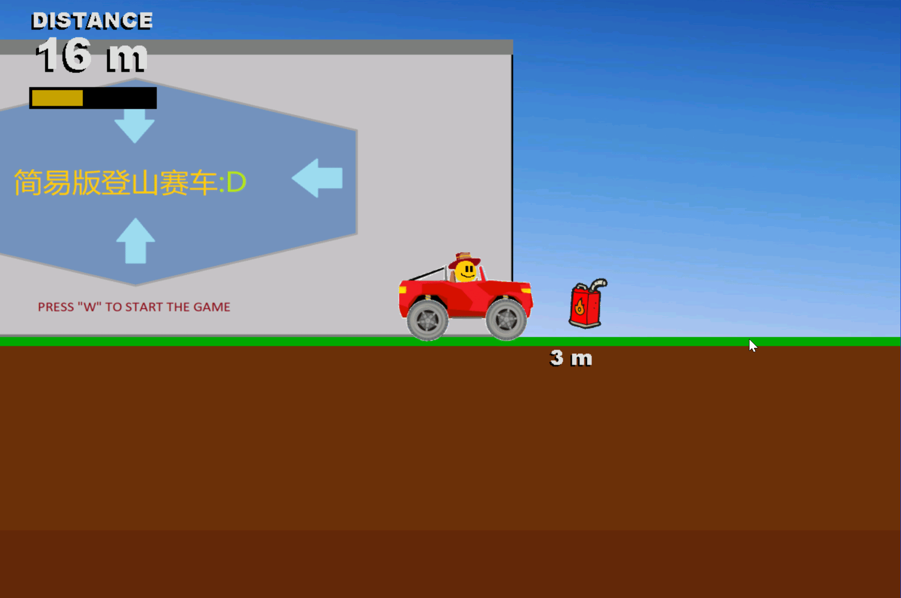

# My First Game

2023.3
初学编程用 **C++ 和 EasyX** 做的小游戏




## 操作

| 按键 | 作用 |
| --- | --- |
| `W` | 开始 |
| `↑` / `↓` | 驱动车轮沿两个方向转动 |
| `←` / `→` | 调整车辆的水平运动和旋转 |
| `R` | 游戏结束后重新开始 |
| `Esc` | 游戏结束后退出 |

## 在 Windows 上运行

仓库保留了原有的可执行文件 `physical engine.exe`。

下载或克隆完整仓库，保持该文件与 `images/` 目录位于同一层级，然后从项目根目录运行：

```powershell
& ".\physical engine.exe"
```

游戏通过 `./images/` 相对路径加载图片，因此运行时的工作目录应为项目根目录。

该可执行文件是原项目中已有的版本，本次归档未重新编译或验证其在当前系统上的兼容性。

## 从源码编译

- 平台：Windows。
- 编译环境：支持 Windows 桌面 C++ 的 Visual Studio / MSVC。
- 图形依赖：EasyX，源码使用 `graphics.h`。
- 入口源码：根目录下的 `physic.cpp`。

原项目未附带 Visual Studio 工程文件。可创建 C++ 项目、配置 EasyX 并添加 `physic.cpp`；运行时将工作目录设为本仓库根目录。

**源码保留原始 GBK（Windows CP936）编码。** 如果中文注释或界面文字显示乱码，请先检查编辑器和编译器的源码编码设置。

## 文件说明

```text
My-first-game/
├── physic.cpp             # 游戏与物理逻辑
├── physical engine.exe    # 原有 Windows 可执行文件
├── images/                # 原始图片资源及历史文件
├── showcase.gif           # 游戏演示
└── README.md
```

> 大一，初学者的谬误。。全写一个文件里了，以后再做会改正的
> 还有你知道我有多讨厌AI帮我上传的时候写的这个README文件吗，太正式了，太糟糕了。。
